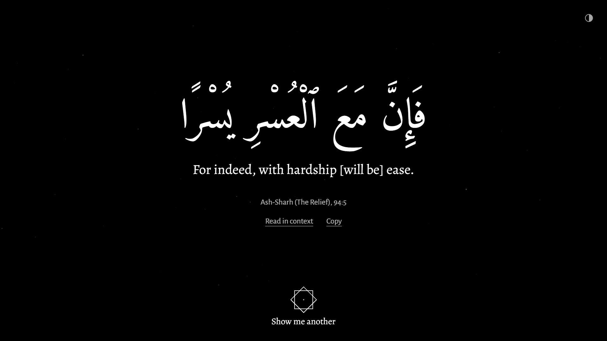
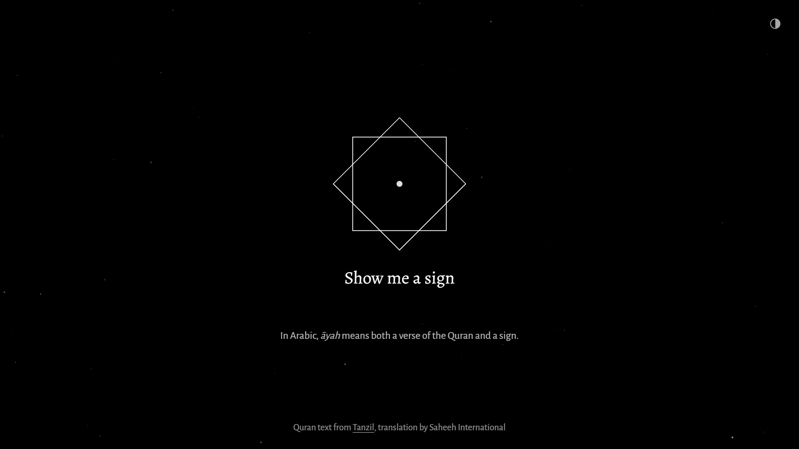
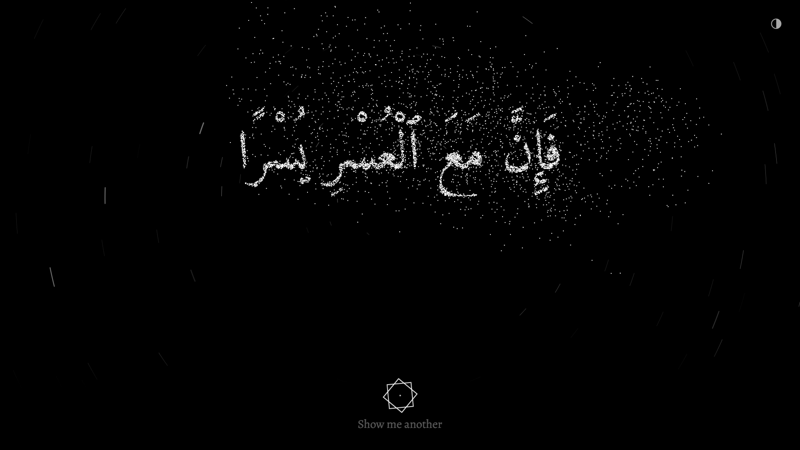
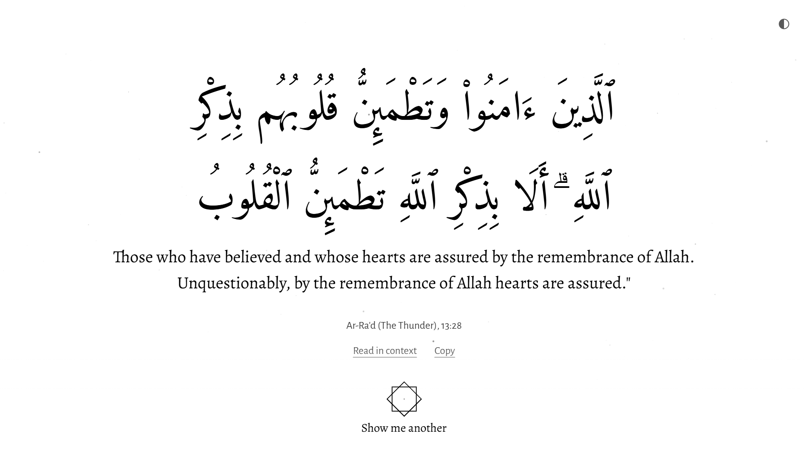
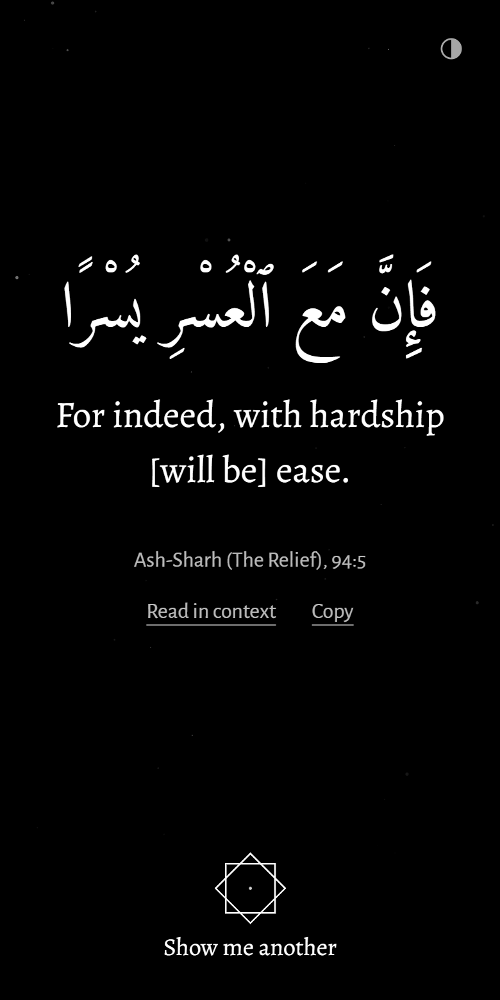

# Show me a sign

Press the star and read one ayah of the Quran, with its English translation.

In Arabic, *āyah* means both a verse of the Quran and a sign.

### [Open the page](https://ibrahimahtsham.github.io/a-sign/)

## Screenshots

| Start | Dots becoming the next ayah |
| --- | --- |
|  |  |

**Light mode**

**Phone**

## What it does

- Picks from all 6,236 ayahs and does not repeat one until you have seen them all or reloaded the page
- Writes the Arabic from right to left out of moving dots, then fades in the English
- Gives every ayah its own link, for example [`#94:5`](https://ibrahimahtsham.github.io/a-sign/#94:5)
- Copies the ayah, or opens it on quran.com so you can read the verses around it
- Pure black and white, dark by default, with a light mode
- Respects the reduced motion setting on your device, with a switch to turn animation on

## How it is made

Plain HTML, CSS and JavaScript. No framework and no build step.

| File | What is in it |
| --- | --- |
| `index.html` | The page |
| `style.css` | Layout, colors and transitions |
| `app.js` | Night sky, dot animation, picking and showing ayahs |
| `quran.js` | Arabic text, translation and surah names |

To run it yourself, download the repo and open `index.html`.

## Credits

- Arabic text: [Tanzil](https://tanzil.net) (Uthmani)
- English translation: Saheeh International
- Both downloaded through the [AlQuran Cloud API](https://alquran.cloud/api), surah names from [Quran.com](https://quran.com)
- Fonts: Amiri Quran, Alegreya and Alegreya Sans
